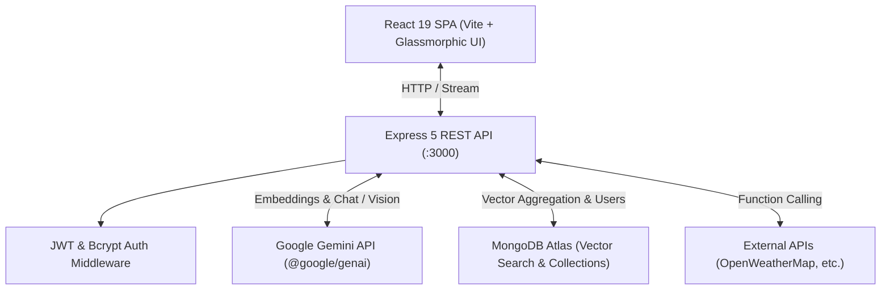

# ⚡ Evaluation AI — Multimodal & Advanced RAG Agentic Platform

[](https://react.dev/)
[](https://vitejs.dev/)
[](https://nodejs.org/)
[](https://ai.google.dev/)
[](https://www.mongodb.com/products/platform/atlas-vector-search)
[](https://www.docker.com/)

An enterprise-ready, full-stack AI evaluation and orchestration platform powered by **Google Gemini models**, **MongoDB Atlas Vector Search**, and a modern **React 19** frontend. Features autonomous agent reasoning loops, Hybrid Retrieval-Augmented Generation (RAG) with Reciprocal Rank Fusion (RRF), real-time streaming, multimodal vision, and comprehensive document intelligence.

---

## 🌟 Key Features

### 1. 🤖 Intelligent Multi-Mode Chat
- **General AI Assistant**: Direct conversation with ultra-fast latency using Gemini models.
- **Streaming Response**: Low-latency token-by-token streaming via server-sent chunks.
- **RAG Chat**: Context-grounded dialogue referencing ingested documents with semantic source citations and relevance scores.
- **Autonomous Agent Mode**: Step-by-step thinking with observation loops and dynamic planning.

### 2. 📚 Advanced RAG (Retrieval-Augmented Generation) Engine
- **Dense Vector Search**: Powered by `gemini-embedding-001` (768 dimensions) and MongoDB Atlas `$vectorSearch`.
- **Hybrid Retrieval**: Combines sparse keyword search with dense semantic embeddings.
- **Reciprocal Rank Fusion (RRF)**: Re-ranks keyword and vector candidates into a consolidated relevance hierarchy.
- **Query Rewriting & Expansion**: Generates sub-queries and synonym variations to boost search recall.
- **Chunking Pipeline**: Word-based sliding-window chunking with overlap for context preservation.

### 3. 🧠 Autonomous Agents & Function Calling
- **ReAct Agent Loop**: Iterative **Reasoning ➔ Action ➔ Observation ➔ Final Answer** cycle.
- **Dynamic Tool Execution**: Native tool-calling integration (e.g., live weather queries via OpenWeatherMap API, math operations).
- **Plan & Execute Controller**: Breaks complex queries down into sequential steps and executes them deterministically.

### 4. 👁️ Multimodal Vision & Document Intelligence
- **Vision Analyzer**: Image inspection, object identification, and structured data extraction.
- **PDF Ingestion & Parsing**: In-memory document processing via `multer` and `pdf-parse`, chunking text into vector embeddings on the fly.

### 5. 🔐 Authentication & Session Management
- **JWT Authentication**: Secure user registration, password hashing (`bcrypt`), and token validation middleware.
- **Session Continuity**: Multi-session management with local storage synchronization and chat history exploration.

### 6. 📊 System Observability & Health
- Real-time connection monitoring, backend latency tracking, and status telemetry.

---

## 🏗️ System Architecture



---

## 🛠️ Tech Stack

| Layer | Technology |
|---|---|
| **Frontend** | React 19, Vite 6, Lucide React, Marked, PrismJS, Custom Cyberpunk CSS |
| **Backend** | Node.js (ES Modules), Express 5, `@google/genai` SDK, Mongoose 9 |
| **Document Processing** | Multer, `pdf-parse`, custom chunking utilities |
| **Database & Search** | MongoDB & MongoDB Atlas Vector Search |
| **AI Models** | `gemini-3.6-flash-lite`, `gemini-3.5-flash`, `gemini-embedding-001` |
| **Deployment** | Docker, Docker Compose, Nginx |

---

## 📁 Project Structure

```text
.
├── ai-express/                 # Express Backend Service
│   ├── config/
│   │   ├── ai.js               # GoogleGenAI SDK configuration
│   │   └── db.js               # Mongoose database connection
│   ├── controllers/
│   │   ├── ai.controllers.js   # Chat, RAG, RRF, Agents, Vision & Ingestion handlers
│   │   └── user.controller.js # Signup & Login handlers
│   ├── middlewares/
│   │   ├── Auth.js             # JWT verification middleware
│   │   └── upload.middleware.js# Multer memory storage
│   ├── models/
│   │   ├── User.model.js       # User auth schema
│   │   └── embedding.models.js # Chunk embeddings schema
│   ├── routes/
│   │   ├── User.routes.js      # Auth endpoints
│   │   └── ai.routes.js        # AI, RAG & Agent endpoints
│   ├── services/
│   │   ├── ai.services.js      # Gemini prompt engineering, ReAct loops, RAG logic
│   │   └── User.services.js    # Password hashing & JWT generation
│   ├── utils/
│   │   └── chunkText.js        # Word-based text chunker
│   ├── Dockerfile
│   └── package.json
│
├── frontend/                   # React 19 Frontend Client
│   ├── src/
│   │   ├── api/                # Axios API clients & interceptors
│   │   ├── components/
│   │   │   ├── AdvancedRAG/    # RAG Explorer & Vector inspector
│   │   │   ├── Auth/           # Login & Register views
│   │   │   ├── Chat/           # Chat container, Timeline, & Sources
│   │   │   ├── KnowledgeBase/  # Document uploader & viewer
│   │   │   ├── Navigation/     # Sidebar & Header
│   │   │   ├── System/         # Latency & Health dashboards
│   │   │   ├── Tools/          # Agent Studio & Tool tester
│   │   │   └── Vision/         # Multimodal image analysis
│   │   ├── context/            # Authentication context
│   │   ├── App.jsx             # Root layout & session management
│   │   └── index.css           # Glassmorphism dark mode styles
│   ├── Dockerfile
│   ├── nginx.conf
│   └── package.json
│
├── docker-compose.yml          # Multi-container orchestration
└── README.md
```

---

## 🚀 Getting Started

### Prerequisites
- [Node.js](https://nodejs.org/) (v18+ recommended)
- [MongoDB Atlas](https://www.mongodb.com/) account with a cluster supporting Vector Search
- [Google AI Studio Gemini API Key](https://aistudio.google.com/)
- [OpenWeatherMap API Key](https://openweathermap.org/) (optional, for weather tool)
- [Docker](https://www.docker.com/) (optional, for containerized run)

---

### 1. Environment Configuration

Create a `.env` file inside `ai-express/`:

```bash
touch ai-express/.env
```

Add the following environment variables:

```env
PORT=3000
MONGO_URL=mongodb+srv://<username>:<password>@cluster0.mongodb.net/ai_evaluation?retryWrites=true&w=majority
GEMINI_API_KEY=your_gemini_api_key_here
WEATHER_API_KEY=your_openweathermap_api_key_here
JWT_SECRET=your_super_secret_jwt_key
```

---

### 2. MongoDB Atlas Vector Search Setup

To enable Vector Search on the `embeddings` collection, create an **Atlas Vector Search Index** in MongoDB Atlas:

- **Database**: `ai_evaluation` (or your configured db)
- **Collection**: `embeddings`
- **Index Name**: `vector_index` (or default specified in query)
- **Configuration JSON**:
```json
{
  "fields": [
    {
      "type": "vector",
      "path": "embedding",
      "numDimensions": 768,
      "similarity": "cosine"
    },
    {
      "type": "filter",
      "path": "source"
    }
  ]
}
```

---

### 3. Local Development

#### A. Start Backend
```bash
cd ai-express
npm install
node server.js
```
The server will start on `http://localhost:3000`.

#### B. Start Frontend
```bash
cd frontend
npm install
npm run dev
```
Open your browser at `http://localhost:5173`.

---

### 4. Running with Docker Compose

To build and run both services simultaneously with Docker:

```bash
docker compose up --build
```

- **Frontend**: `http://localhost:80`
- **Backend**: `http://localhost:3000`

---

## 📡 API Endpoints

### 🔐 Authentication (`/api/auth`)
| Method | Endpoint | Description |
|---|---|---|
| `POST` | `/api/auth/signup` | Register a new user |
| `POST` | `/api/auth/login` | Authenticate user and issue JWT |

### 🤖 AI Core & Streaming (`/api/v1`)
| Method | Endpoint | Description |
|---|---|---|
| `POST` | `/api/v1/chat` | Generate standard conversational response |
| `POST` | `/api/v1/chunk` | Stream token response in real-time |
| `POST` | `/api/v1/fast-chat` | Quick response with lightweight reasoning |

### 📚 RAG & Document Intelligence (`/api/v1`)
| Method | Endpoint | Description |
|---|---|---|
| `POST` | `/api/v1/upload-docs` | Upload PDF, parse text, chunk, and index embeddings |
| `POST` | `/api/v1/rag-ans` | Retrieve context via vector search and answer query |
| `POST` | `/api/v1/ret` | Sparse keyword search across indexed chunks |
| `POST` | `/api/v1/rrf` | Hybrid search combining vector + keyword with Reciprocal Rank Fusion |
| `POST` | `/api/v1/expandQuery` | Rewrite and expand search queries |
| `POST` | `/api/v1/filterRag` | Vector search filtered by specific document source |

### 🛠️ Agents & Tools (`/api/v1`)
| Method | Endpoint | Description |
|---|---|---|
| `POST` | `/api/v1/agent` | Autonomous ReAct agent with reasoning and execution |
| `POST` | `/api/v1/planningexecution` | Structured plan creation and step-by-step execution |
| `POST` | `/api/v1/functioncall` | Automated function calling with Gemini SDK |
| `POST` | `/api/v1/weathercontrol` | Execute weather tool via OpenWeatherMap API |

### 👁️ Multimodal Vision (`/api/v1`)
| Method | Endpoint | Description |
|---|---|---|
| `POST` | `/api/v1/image` | Multimodal image understanding and extraction |
| `POST` | `/api/v1/pdf` | PDF analysis and text summarization |

---

## 🤝 Contributing

Contributions are welcome! Please follow these steps:
1. Fork the repository.
2. Create a feature branch: `git checkout -b feature/amazing-feature`.
3. Commit your changes: `git commit -m "Add amazing feature"`.
4. Push to the branch: `git push origin feature/amazing-feature`.
5. Open a Pull Request.

---

## 📄 License

This project is licensed under the **ISC License**.
